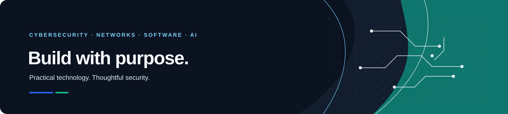

# Hi, I'm <!-- PROFILE_NAME_START -->PrudenceMatrix<!-- PROFILE_NAME_END --> 👋

### <!-- PROFILE_TITLE_START -->Cybersecurity | Network Security | Linux &amp; Networking<!-- PROFILE_TITLE_END -->

  

<!-- PROFILE_INTRO_START -->Securing systems, hardening Linux, and understanding networks from the packet up.<!-- PROFILE_INTRO_END -->

  <!-- PROFILE_LINKS_START -->

<!-- PROFILE_LINKS_END -->

---

## 👨‍💻 About Me

<!-- ABOUT_START -->Cybersecurity and network security are my primary focus, with hands-on work in Linux, network reconnaissance, security operations, and defensive testing. I also build web projects and explore AI and machine learning, with databases as a supporting skill.<!-- ABOUT_END -->

- 🛡️ Cybersecurity, security analysis, and defensive testing
- 🌐 Network security, TCP/IP, reconnaissance, and troubleshooting
- 🐧 Linux security, Kali Linux, and system hardening
- 💻 Web development as a secondary skill
- 🤖 AI & machine learning, followed by database technologies

> Security mindset: understand the system, reduce exposure, and build resilience.

---

## 🧰 Tech Stack

**Cybersecurity · Linux · Networking**

**Web Development · Languages · Tools**

**AI & Machine Learning**

**Databases**

---

## 🚀 Featured Projects

<!-- FEATURED_PROJECTS_START -->
| Project | Area | What it demonstrates |
|---|---|---|
| [Cybersecurity Labs & CTF Writeups](https://github.com/PrudenceMatrix/networkwalks-cybersecurity-ctf-writeups) | Cybersecurity & Security Operations | Documented hands-on cybersecurity labs and challenge write-ups. |
| [SOC Level 1 Analyst Labs](https://github.com/PrudenceMatrix/soc-level-1-analyst) | Cybersecurity & Security Operations | Hands-on SOC labs covering Wazuh, Splunk, Sysmon, detections, playbooks, and incident reports. |
| [Web Application Security Assessment](https://github.com/PrudenceMatrix/mediroza-hospital-pentesti-final-week4) | Cybersecurity & Security Operations | Authorized security assessment with documented findings, evidence and remediation analysis. |
| [Network Footprinting & Reconnaissance Assessment](https://github.com/PrudenceMatrix/network-footprinting-assessment) | Network Engineering | An authorized network reconnaissance assessment using common footprinting and information-gathering techniques. |
<!-- FEATURED_PROJECTS_END -->

---

## 🎯 Security & Networking Focus

- Linux security, system hardening, and secure administration
- Network security, TCP/IP, traffic analysis, and reconnaissance
- Cybersecurity operations, vulnerability assessment, and defensive testing
- Security automation and practical tooling
- AI/ML and databases as complementary technical areas

---

## 📊 GitHub Statistics

 

### 📈 Contribution Activity

<a href="https://github.com/PrudenceMatrix">
  <picture>
    <source media="(prefers-color-scheme: dark)" srcset="https://github-readme-activity-graph.vercel.app/graph?username=PrudenceMatrix&bg_color=0d1117&color=38BDF8&line=2563EB&point=ffffff&area=true&hide_border=true"/>
    
  </picture>
</a>

  

<picture>
  <source media="(prefers-color-scheme: dark)" srcset="https://raw.githubusercontent.com/PrudenceMatrix/PrudenceMatrix/output/github-snake-dark.svg"/>
  
</picture>

---

## 🧭 Skills, in Priority Order

<!-- SKILLS_START -->
| Area | Skills & tools |
|---|---|
| **Cybersecurity** | `Penetration Testing` · `Vulnerability Assessment` · `Security Analysis` · `Web Application Security` · `Password Security Testing` · `Linux Security` · `Security Operations` |
| **Network Security & Networking** | `Network Security` · `Network Reconnaissance` · `TCP/IP` · `Network Scanning` · `Network Troubleshooting` · `Nmap` |
| **Linux & Systems** | `Linux` · `Kali Linux` · `System Hardening` · `Shell` |
| **Web Development** | `HTML` · `CSS` · `JavaScript` · `Node.js` · `Next.js` |
| **AI & Machine Learning** | `Machine Learning` · `AI Development` · `Data Processing` · `Model Development` |
| **Databases** | `PostgreSQL` · `MariaDB` · `SQL` |
| **Programming** | `Python` · `Java` · `VB.NET` · `JavaScript` · `TypeScript` |
<!-- SKILLS_END -->

## Technology Stack

<!-- TECHNOLOGY_STACK_START -->
`Linux` · `Kali Linux` · `Wazuh` · `Splunk` · `Sysmon` · `Nmap` · `TCP/IP` · `Git` · `scikit-learn` · `PHP` · `Python` · `Jupyter Notebook` · `CSS` · `HTML` · `JavaScript` · `TypeScript` · `Java` · `Shell` · `TSQL` · `C` · `Makefile`
<!-- TECHNOLOGY_STACK_END -->

## All Public Projects

Every public repository is included below, grouped by the kind of work it demonstrates. Forks are labelled; a fork is not presented as an original project.

<!-- REPOSITORIES_START -->
### 🛡️ Cybersecurity & Security Operations

| Project | What it covers |
|---|---|
| [Cybersecurity Labs & CTF Writeups](https://github.com/PrudenceMatrix/networkwalks-cybersecurity-ctf-writeups) | Documented hands-on cybersecurity labs and challenge write-ups. |
| [SOC Level 1 Analyst Labs](https://github.com/PrudenceMatrix/soc-level-1-analyst) | Hands-on SOC labs covering Wazuh, Splunk, Sysmon, detections, playbooks, and incident reports. |
| [Web Application Security Assessment](https://github.com/PrudenceMatrix/mediroza-hospital-pentesti-final-week4) | Authorized security assessment with documented findings, evidence and remediation analysis. |
| [Cybersecurity Lab Setup](https://github.com/PrudenceMatrix/NETWORKWALKS-B082-WK1-PM1-CYBERSECURITY-LAB-SETUP) | An isolated Kali Linux lab setup for learning security assessment and defensive operations. |
| [h4cker Security Reference (Fork)](https://github.com/PrudenceMatrix/h4cker) · Fork | A fork of a broad, community-maintained collection of cybersecurity and ethical hacking references. |

### 🌐 Network Engineering

| Project | What it covers |
|---|---|
| [Network Footprinting & Reconnaissance Assessment](https://github.com/PrudenceMatrix/network-footprinting-assessment) | An authorized network reconnaissance assessment using common footprinting and information-gathering techniques. |
| [Network Enumeration with Nmap](https://github.com/PrudenceMatrix/Network_Enumeration_With_Nmap) · Fork | A practical overview of host discovery, open ports, and service enumeration for authorized security work. |

### 🌱 Web Development

| Project | What it covers |
|---|---|
| [Personal Portfolio](https://github.com/PrudenceMatrix/my-portfolio) | A personal portfolio website built with TypeScript. |
| [PrudenceMatrix](https://github.com/PrudenceMatrix/PrudenceMatrix) · **NEW** | GitHub Portfolio  |
| [Student Placement Management System](https://github.com/PrudenceMatrix/iosss-student-placement-system) | A PHP and database system for managing student school placement. |

### 🧠 AI & Machine Learning

| Project | What it covers |
|---|---|
| [AI Shopping Agent & Payment Security System](https://github.com/PrudenceMatrix/mandate-agent) | An AI-driven shopping agent with payment safeguards, security testing and audit capabilities. |
| [Credit Scoring Model](https://github.com/PrudenceMatrix/CodeAlpha_CreditScoringModel) | A Python and scikit-learn project that predicts credit risk from historical financial data. |
| [Disease Prediction Model](https://github.com/PrudenceMatrix/CodeAlpha_DiseasePredictionModel) | A Python project exploring disease prediction with a machine-learning model. |
| [Handwritten Character Recognition](https://github.com/PrudenceMatrix/CodeAlpha_HandwrittenCharacterRecognition) | A Python project focused on recognizing handwritten characters. |

### ⚙️ Software Development

| Project | What it covers |
|---|---|
| [Java Simple Casino Game](https://github.com/PrudenceMatrix/JAVA_Simple_Casino_Game) | A small casino game project implemented in Java. |
| [Personal Contact Manager](https://github.com/PrudenceMatrix/Personal-Contact-Manager) | A Python application for managing personal contacts. |
<!-- REPOSITORIES_END -->

## GitHub at a Glance

<!-- GITHUB_STATS_START -->
| Public repositories | Followers | Following | Stars across public repositories |
|:---:|:---:|:---:|:---:|
| **16** | **2** | **13** | **12** |

**Languages detected across public repositories:** `Python` · `Jupyter Notebook` · `PHP` · `CSS` · `HTML` · `JavaScript` · `TypeScript` · `Java` · `Shell` · `TSQL`

Public GitHub data · refreshed 2026-11-13
<!-- GITHUB_STATS_END -->

---

## 🤝 Let's Connect

I'm always interested in collaborating on meaningful technical work, security projects, and practical systems.

  

### Build. Test. Secure. Improve.

*Developing software with purpose.*

